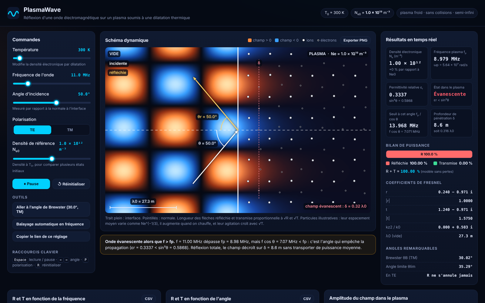

# PlasmaWave

Réflexion d'une onde électromagnétique sur un plasma soumis à une dilatation thermique.

Mini-projet d'électromagnétisme, GSR1, ENSA Tanger. Enseignant : M. El Mamouni.



## Utilisation

Aucune installation : ouvrir `index.html` dans un navigateur (Firefox, Chrome, Edge), sur ordinateur ou sur téléphone.

Vérifier le modèle physique (Node.js) :

```bash
node physics.test.js
```

## Modèle physique

Plasma idéal, non magnétisé, sans collisions, homogène et semi-infini. Dilatation à pression constante, degré d'ionisation constant, température commune aux espèces.

- Ne(T) = Ne0 · T0 / T, avec T0 = 300 K
- ωp = √(Ne e² / (ε0 me)) et εr = 1 − ωp² / ω²
- kz1 = k0 cos θ dans le vide, kz2 = k0 √(εr − sin²θ) dans le plasma
- Propagation si εr > sin²θ, soit ω cos θ > ωp. Sinon kz2 est imaginaire (Im kz2 > 0) : onde évanescente.
- Fresnel : r_TE = (kz1 − kz2) / (kz1 + kz2), r_TM = (εr kz1 − kz2) / (εr kz1 + kz2), t = 1 + r (pour H en TM)
- Puissances : R = |r|², T_TE = Re(kz2) / kz1 · |t|², T_TM = Re(kz2 / εr) / kz1 · |t|²
- δ = 1 / Im(kz2), tan θB = √εr

## Fonctionnalités

- Curseurs : température, fréquence, angle d'incidence, densité de référence Ne0 (échelle logarithmique), choix TE / TM, lecture / pause, réinitialisation
- Schéma animé : champ réel calculé en chaque point du vide et du plasma, ondes incidente, réfléchie et transmise, champ évanescent avec repère de δ, normale, angles, échelle λ0, particules dont l'espacement suit Ne^(−1/3) et l'agitation suit √T
- Résultats en temps réel : Ne, fp, εr, état de l'onde, seuil fp / cos θ, angle de réfraction ou profondeur de pénétration, bilan R + T, coefficients de Fresnel, angles de Brewster et limite
- Courbes R et T en fonction de la fréquence et de l'angle, avec zone évanescente, repères et réglage actuel ; cliquer ou glisser sur la courbe change la fréquence ou l'angle
- Profil de l'amplitude du champ dans le plasma
- Explorations guidées (5 scénarios), balayage automatique en fréquence, accès direct à l'angle de Brewster
- Export PNG du schéma, export CSV des courbes, lien de partage qui conserve le réglage
- Raccourcis clavier : Espace, ← →, P, R
- Aucune dépendance : HTML, CSS et JavaScript

## Fichiers

- `index.html` : structure de la page
- `style.css` : mise en forme
- `physics.js` : modèle physique (mêmes formules que le cours)
- `app.js` : interface, schéma animé et courbes
- `physics.test.js` : vérifications du modèle

## Mise en ligne (Vercel)

1. Créer un dépôt GitHub et y déposer ces fichiers.
2. Sur vercel.com, se connecter avec GitHub, cliquer sur « Add New… » puis « Project ».
3. Importer le dépôt, laisser « Framework Preset » sur « Other », sans commande de build.
4. Cliquer sur « Deploy ». Le site est en ligne à une adresse du type `nom-du-projet.vercel.app`.

Réalisé par Hiba El Moumene.
